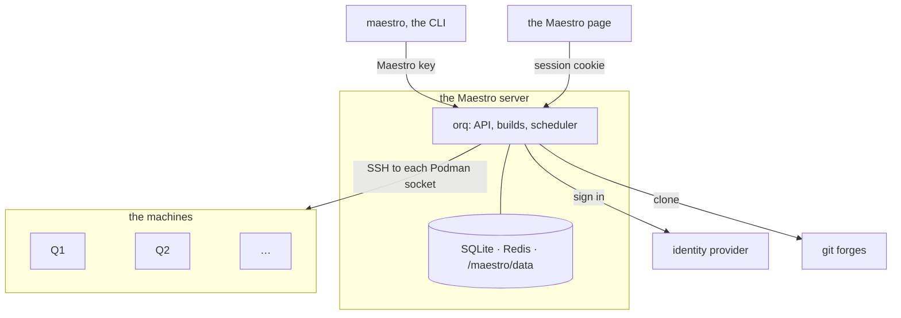
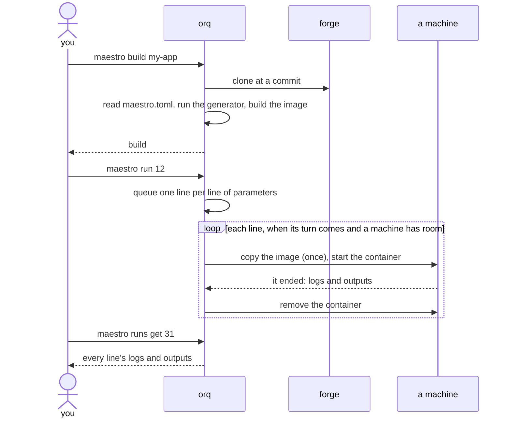

# How the parts fit

Maestro is three programs and the machines they drive.

**orq** is the server, and the only part that decides anything. It signs
people in through the lab's identity provider, clones repos with the forge
tokens the CLI hands it, builds images with its own Podman, keeps every
build, run and line in SQLite, and runs the scheduler: the loop that picks
which waiting line goes where, copies images to machines, starts containers,
and collects what they leave. orq keeps everything about runs in its
database, so it can restart in the middle of one and pick up where it was.

**The view** is the Maestro page: a web page served beside orq, on the same
host, that shows your runs and their files, the queue and your usage, and
the admin pages. It holds no state of its own.

**The CLI**, `maestro`, does everything from a terminal, and keeps on your
computer only the server's URL, your Maestro key and your forge tokens.

**The machines** are computers with Podman and sshd, nothing else. orq
reaches each over SSH and talks to its Podman socket through that
connection: it copies images there, starts containers, reads how loaded the
machine is, and takes the outputs back when a container ends. Containers are
removed once their outputs are kept; images stay, so the next run of a build
starts without copying it again.

## The life of a run

The [queue](watch/queue.md) is where most of a line's life is spent on a busy
day; [Scheduler policies](admin/policies.md) says how its turns are decided.
