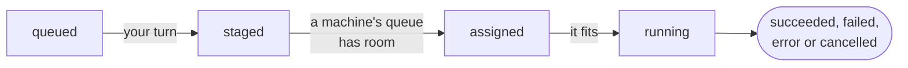

# The queue, explained

The machines are shared, so on a busy day a line spends most of its life
waiting. This page says where it waits, what it waits for, and how to have
it wait less.

```sh
maestro queue      # how many lines wait at each level, yours and everyone's
```

## Three levels of waiting



**queued.** `maestro run` queues every line of the run among your own
lines. Which of yours goes next is the first policy's choice (by default,
oldest run first, then line by line).

**staged.** Your lines are staged a few at a time, against the other users
of your group: each group has at most twice as many lines staged as there
are machines. Whose line is staged next is the second policy's choice, and
can weigh how much of the machines each user already holds.

**assigned.** Groups take turns at the machines. In its group's turn, a
staged line goes to a machine it may run on (by its `machines`) that has
room in its queue: only three lines wait on each machine. While it waits
there, the server copies its image to the machine if the machine doesn't have
it yet.

**starting, running.** The machine starts the line once its cores and
memory fit in what the machine has free. Which of its three waiting lines
fits first is the machine's own policy's choice.

Keeping only three lines on each machine means which user's line goes next
is decided as late as it can be, so someone who queues a single line behind
another's thousand doesn't wait for all thousand.

## Why is my line waiting?

`maestro queue` shows how many of your lines are at each level, everyone's,
your group, how many of its lines are staged against how many it may have,
and your share of the machines. The Maestro page has the same under Queue,
read again every 5 seconds.

- **Many `queued`, few `staged`.** Others in your group are being served
  first: your group may only have so many lines staged, and the policy
  chose theirs. With a share-weighted policy, someone holding less of the
  machines than you goes first.
- **Many `staged`.** The machines' queues are full, or it's another group's
  turn. Lines that may only run on some machines (`machines = [...]`) wait
  for those.
- **`assigned` for long.** The machine has no room yet for the line's cores
  and memory, or its image is still being copied there (only the first run
  of a build on that machine).
- **A large line waits while smaller ones start.** On a machine whose policy
  fits lines into the free space (best-fit, Tetris, FIFO-skip), smaller
  lines can go around a large one; under FIFO, the line that doesn't fit
  holds the others back instead.

`maestro top` shows how much of each machine lines take, and how many lines
wait there (`6/14 +3`); see [Watching the machines](top.md).

## Waiting less

- **Ask for what you need.** A line starts only where its `cpus` and
  `memory` fit, so a smaller line fits sooner and in more places. A run with
  a line larger than every machine it may use, even empty, is refused.
- **Allow more machines.** Leave `machines` out unless the program needs
  particular ones.
- **Keep images small.** The first line of a build on each machine waits
  while the image is copied.

## Machines that go away

A machine the server can't reach, over SSH or to its Podman socket, gets no
lines until it can: those waiting or about to start there go back to
`staged`, for another machine, rather than ending in an error, and the
server tries the machine again every 30 seconds. Lines already running there
are left alone, and looked at again once it is back.

## The settings now

```sh
maestro settings
```

shows how the scheduler is set up: the four policies and their weights. Each
line records the settings it was staged under, and its user's group, so
[`maestro export`](usage.md) can tell how each line was served. [Scheduler
policies](../admin/policies.md) explains every policy an administrator can
choose.
